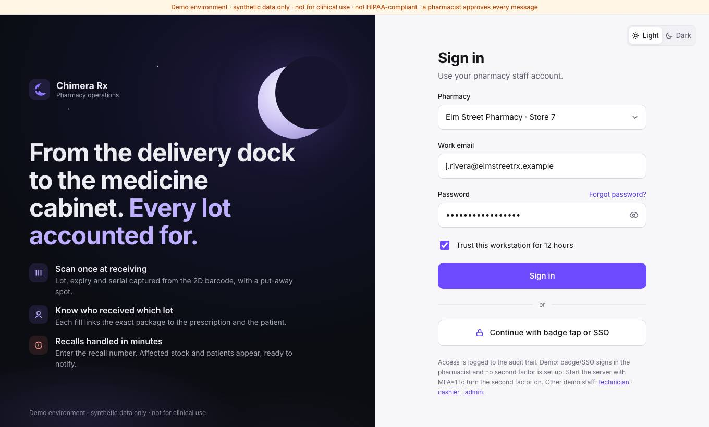
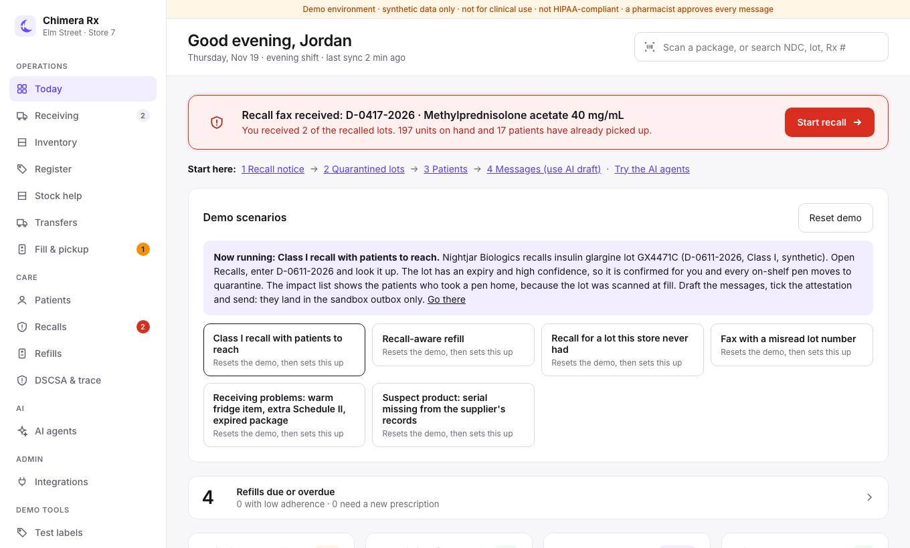
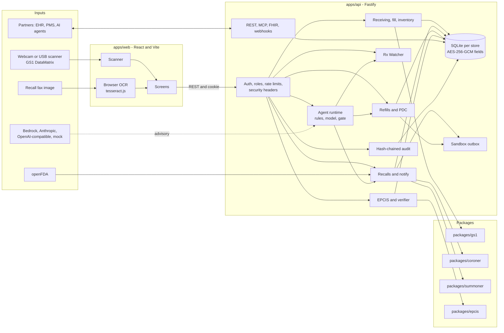
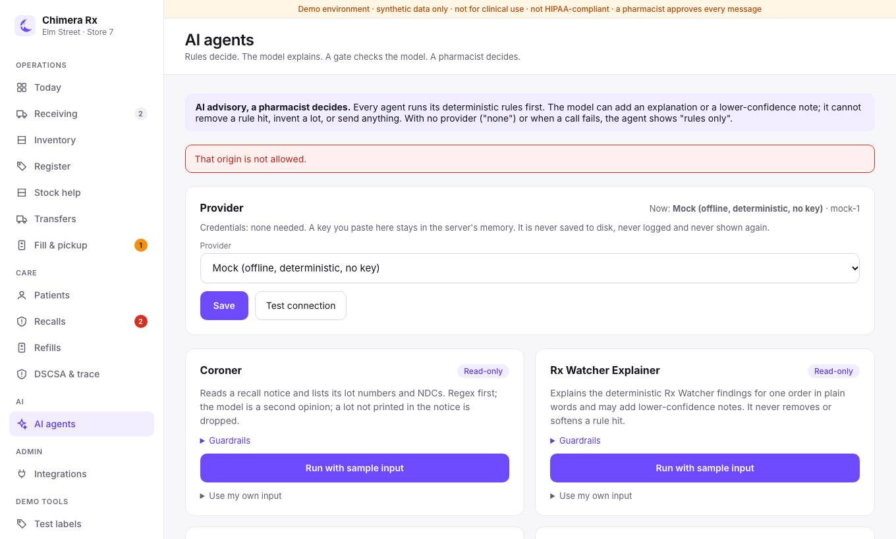

# Chimera Rx

Chimera Rx is a pharmacy lot ledger that records which lot and serial each patient took home, so a recall turns into a list of shelf units and patients in about a minute instead of a phone-everyone exercise.

**Kiroween 2026, Frankenstein category. Built with Kiro.** Demo environment: synthetic data only, not for clinical use, not HIPAA-compliant, no compliance or certification claim of any kind. See [docs/SAFETY.md](docs/SAFETY.md).



## The gap

Wholesalers track drugs by lot. Dispensing systems track drugs by patient. Nobody links the two: the lot number is printed in the 2D barcode on every package, but it is not captured at the counter. When a lot is recalled, a pharmacy warns everyone who ever got that drug, or no one.

Chimera Rx captures lot and serial at receiving and again at fill (GS1 DataMatrix by camera or USB scanner, or OCR for labels without a barcode). A recall then resolves to the units on the shelf, which are quarantined, and the patients who took one home, who get drafted messages that a pharmacist approves.



## Try it in 60 seconds

Docker (one command):

```bash
docker compose up        # then open http://localhost:4000
```

No Docker (Node 22.5 or newer, pnpm 12):

```bash
pnpm install --frozen-lockfile
pnpm setup               # once: downloads the OCR model, renders the demo fax image
pnpm dev                 # API on :4000, web app on :5173 -> open http://localhost:5173
```

`pnpm setup` needs network access once (OCR model download). Nothing else needs a key. The AI agents run offline with `LLM_PROVIDER=mock` or `none`; the default provider is Bedrock, which needs AWS credentials (see [AI agents](#ai-agents)). The Docker image sets `LLM_PROVIDER=none` so a judge sees rules-only output with no credentials, and can switch provider on the AI agents screen.

`docker compose up` was **not run on the machine that wrote this repo** (no reachable Docker daemon). `docker-compose config` validated the file, and the same app was installed, built and served from source (`pnpm install --frozen-lockfile`, `pnpm setup`, `pnpm build:web`, API from source).

### Demo accounts

All accounts share the password `moonlight-rx-2026`. Pick the pharmacy on the sign-in page.

| Store | Email | Role | Sees |
| --- | --- | --- | --- |
| Elm Street, Store 7 | `j.rivera@elmstreetrx.example` | Pharmacist | Everything, and the only role that confirms, verifies and sends |
| Elm Street, Store 7 | `k.patel@elmstreetrx.example` | Technician | Receiving, inventory, fill, patients, stock help, refills, DSCSA, agents; cannot send messages or confirm lots |
| Elm Street, Store 7 | `m.diaz@elmstreetrx.example` | Cashier | Register and pickup only, no allergies or dates of birth, no outbox |
| Elm Street, Store 7 | `s.grant@elmstreetrx.example` | Admin | Integrations, agent provider settings |
| Birch Avenue, Store 2 | `s.okoro@birchavenuerx.example` | Pharmacist | Everything in Store 2 only |
| Birch Avenue, Store 2 | `t.lund@birchavenuerx.example` | Technician | Store 2 receiving, inventory, fill |
| Birch Avenue, Store 2 | `c.reyes@birchavenuerx.example` | Cashier | Store 2 register and pickup |

The "Badge tap / SSO" button is a demo stand-in that signs in the Store 7 pharmacist. `MFA=1` turns on a second sign-in factor (a 6-digit code delivered to the sandbox outbox) and disables that button.

### Three scenarios to click first

Sign in as the pharmacist and open **Demo guide** in the sidebar for the scenarios (each one resets the data and shows a short brief).

1. **Class I recall with patients to reach.** Recalls, look up `D-0611-2026`: the lot is confirmed, every on-shelf pen moves to quarantine, the impact list names the patients. Draft messages (try **Use AI draft**), tick the attestation, send. They land in the sandbox outbox.
2. **Recall-aware refill.** Open Refills, then look up `D-0611-2026` in Recalls. The patient's refill row turns red and links to the recall.
3. **AI agents.** Open AI agents and press **Run with sample input** on any agent. Output is labelled "AI advisory, a pharmacist decides".

## What it does

| Market gap | Feature | Where to find it |
| --- | --- | --- |
| A recall does not say who got the bad lot | Recall to shelf units and patients, quarantine, consent-checked outreach, PDF audit report | Recalls; `apps/api/src/recall.ts` |
| The lot is never captured at the counter | Lot and serial captured at receiving and at fill by GS1 DataMatrix scan, or OCR for labels with no barcode; the four receiving checks (invoice, transaction information, expiry, recall) | Receiving, Fill & pickup; `packages/gs1`, `apps/web/src/lib/scanner.ts`, `ocr.ts` |
| Order errors reach the patient | Rx Watcher: deterministic rules first, an LLM may only explain or add a lower-confidence note | Fill & pickup; `apps/api/src/rxwatcher.ts` |
| Traceability data is hard to exchange | EPCIS 2.0 export and dry-run import, sandbox verification requests, suspect-product cases, recall trace export. A sandbox, not a filing | DSCSA & trace; [docs/DSCSA.md](docs/DSCSA.md), `packages/epcis` |
| Refills ignore recalls and adherence | Refill worklist with PDC adherence, medication sync, recall hold on recalled-lot patients, Refill Outreach agent | Refills; [docs/REFILLS.md](docs/REFILLS.md) |
| Front-store and pharmacy are separate | Register: over-the-counter items and one patient's verified prescriptions in one sale. "Paid" is a label; no payment is processed | Register; `apps/api/src/register.ts` |
| Chains share stock, small stores cannot | Two stores with separate databases, transfers that keep lot and serial, recalls mirrored to the other store | Transfers, store picker on sign-in; `apps/api/src/crossstore.ts`, `stores.ts` |
| AI is a black box | Seven gated agents, Bedrock by default, swappable provider, every run stored with prompt and dropped output | AI agents; [docs/AGENTS.md](docs/AGENTS.md) |
| Other systems cannot ask the ledger | Partner REST, MCP (JSON-RPC) and FHIR R4 behind OAuth 2.0 client credentials and per-partner scopes; HMAC-signed webhooks | Integrations; `apps/api/src/partner-api.ts`, `webhooks.ts` |
| Logs can be edited | Append-only, hash-chained audit log with a verify route | `GET /api/audit/verify`; `apps/api/src/core.ts` |
| Stock decisions are guesswork | Reorder, expiry-risk and shortage suggestions from rules with the numbers shown | Stock help; `apps/api/src/stockhelp.ts` |

Other parts stitched in: openFDA (live, with fixtures as fallback), the Coroner lot extractor (regex plus optional LLM, keeps a lot only if it is printed in the source), recall voicemail with ElevenLabs, OpenAI, macOS or browser voice (nothing is dialled), and a sandbox NCPDP SCRIPT-shaped `RxChangeRequest` to the prescriber.

## Architecture



Details: [docs/ARCHITECTURE.md](docs/ARCHITECTURE.md).



## AI agents

Rule: rules decide, the model explains, a gate checks the model, a pharmacist decides. With no model, or when a call fails, every agent still returns its rules-only result.

| Agent | What it does |
| --- | --- |
| Coroner | Reads a recall notice; a lot must appear verbatim in the notice |
| Rx Watcher Explainer | Explains rule findings; cannot remove or soften one |
| Recall Outreach Drafter | Rewrites approved message templates; no send path |
| Refill Outreach | Rewrites refill reminders; skips recalled and Schedule II |
| Night Watch | Daily digest of recalls, shortages, expiring lots |
| Stock and Shortage Advisor | One sentence per suggestion, numbers checked |
| Pharmacist Copilot | Answers a question with up to three read-only tools |

Provider is chosen with `LLM_PROVIDER` at start-up (empty means `bedrock`). A pharmacist or admin can also switch provider, model and key on the AI agents screen and press **Test connection**; a pasted key stays in server memory and is never stored, logged or returned.

| Provider | `LLM_PROVIDER` | Environment variables |
| --- | --- | --- |
| Amazon Bedrock (default), Converse API | `bedrock` | `AWS_REGION`, `BEDROCK_MODEL_ID`, and credentials from the default AWS chain (`AWS_PROFILE`, `AWS_ACCESS_KEY_ID`/`AWS_SECRET_ACCESS_KEY`, SSO or an instance role) |
| Anthropic | `anthropic` | `ANTHROPIC_API_KEY`, `ANTHROPIC_MODEL` |
| OpenAI, Azure OpenAI, Ollama, LM Studio, vLLM | `openai-compatible` | `OPENAI_BASE_URL`, `OPENAI_API_KEY` (not needed for local servers), `OPENAI_MODEL` |
| Deterministic and offline | `mock` | none |
| Rules only | `none` | none |

Examples: Ollama is `OPENAI_BASE_URL=http://localhost:11434/v1`, `OPENAI_MODEL=<a model you pulled>`. Adding a provider is about 20 lines ([docs/AGENTS.md](docs/AGENTS.md)).

**Live Bedrock was not exercised on the build machine.** The Bedrock, Anthropic and OpenAI-compatible clients are tested with stub providers and a deterministic mock; no live model call was made.

## Security and privacy

A pilot threat model, not a compliance claim. Full text: [docs/SECURITY.md](docs/SECURITY.md).

- **Encryption at rest.** Patient names, dates of birth, phones, emails, allergies, conditions, prescription directions, message bodies, agent runs and audit reasons are sealed with AES-256-GCM, a fresh 12-byte IV per value, in a versioned envelope with a key id. The list is in `apps/api/src/protect.ts`; a test reads the raw SQLite and WAL bytes and finds no synthetic patient string.
- **Key ring and rotation.** Keys come from `env`, a `file` (mode 0600) or a `kms` placeholder. `pnpm --filter @chimera-rx/api keys:rotate` re-encrypts every protected value under a new key in one transaction per store. A wrong or missing key stops start-up instead of writing under another key.
- **Headers and API.** CSP, nosniff, no-referrer, frame denial, `no-store` on API responses, HSTS when `COOKIE_SECURE=1`; zod validation on every body; errors that never echo input; request logs with no body, URL query or names.
- **Rate limits.** Five wrong passwords lock an account for 15 minutes; failures are also counted per IP and per account name. Counters are per process.
- **Roles.** Checked on the server for every route (pharmacist, technician, cashier, admin). Partners get scoped OAuth tokens; patient data also needs an admin-approved flag.
- **Audit and MFA.** Hash-chained audit, patient views logged with a reason, optional second factor with `MFA=1`.

Not covered: no TLS in the app (put a proxy in front), no KMS or HSM (the default key sits next to the data), columns outside the list are plaintext (message subjects, ids, lot and Rx numbers), no SQLCipher, per-process rate limits, no retention or deletion workflow, no breach process, no independent review or penetration test.

## Safety rules

Eleven rules in [`.kiro/steering/pharmacy-safety.md`](.kiro/steering/pharmacy-safety.md), mapped to code and tests in [docs/SAFETY.md](docs/SAFETY.md):

- Synthetic data only; a hook and CI block PHI-shaped content.
- Nothing reaches a real person: SMS and email go to a sandbox outbox, voicemail is never dialled.
- A pharmacist confirms lots, verifies fills, approves flagged orders and sends messages.
- A lot is never invented; a lot under 0.95 confidence or without expiry needs a person.
- Rules before the LLM; an inferred serial is never shown as scanned.
- A recalled lot stays blocked even after the recall closes.
- Messages carry the minimum, the pharmacy phone and STOP; voicemail never names the medicine.

## Testing

Measured on 2026-11-19 on the machine that built this repo:

| Command | Result |
| --- | --- |
| `pnpm test` | 19 files, 336 tests passed |
| `pnpm typecheck` | clean in all workspaces |
| `pnpm build:web` | builds |
| `pnpm e2e` | 40 of 40 checks passed against a fresh data directory; the MFA check is skipped unless the API runs with `MFA=1` |

Property tests (fast-check, in 9 test files) check that on-hand stock always equals received minus dispensed, returned and adjusted, that no serial is dispensed twice, that the Coroner never emits a lot that is not in the source even when a stub model lies, that GS1 parsing round-trips, and that EPCIS events stay valid. Hostile-provider tests feed lying models to every agent and check the gates.

End-to-end (needs the app running, uses Chromium with a fake webcam and real OCR; `npx playwright install chromium` once if the browser is missing):

```bash
pnpm dev                                  # in one terminal
pnpm e2e                                  # in another; BASE=http://localhost:5173 by default
BASE=http://localhost:5530 pnpm e2e       # against another web port
```

The e2e run resets the data. If the API is not on a dev origin, set `CORS_ORIGINS` (below) or the browser's POSTs are refused. A physical webcam, printed labels and live model providers were not tested.

## Configuration

Every variable is optional. Copy `.env.example` to `.env` to set them.

| Variable | Default | Purpose |
| --- | --- | --- |
| `API_PORT` (or `LG_API_PORT`) | `4000` | API port |
| `API_URL` | `http://127.0.0.1:4000` | Where the Vite dev server proxies `/api`, `/v1`, `/mcp`, `/fhir`, `/oauth`, `/hooks` |
| `DATA_DIR` | `./data` | SQLite files and the key file |
| `DATASET` | `demo` | `large` adds a generated six-month history (about 5,000 fills) |
| `TWO_STORES` | `1` | `0` runs one store |
| `MFA` | `0` | `1` requires a 6-digit code after the password |
| `LG_DEMO` | `1` | Show the demo accounts on sign-in and allow the SSO stand-in |
| `TODAY` | real date | Pretend today is this date (`YYYY-MM-DD`) |
| `NIGHT_WATCH` | on | `0` stops the openFDA poll |
| `MIN_EXPIRY_MONTHS` | `6` | Shortest remaining shelf life accepted at receiving |
| `REFILL_GRACE_DAYS` | `7` | Days past due before a refill counts as overdue (0 to 60) |
| `SANDBOX_DELAY_MS` | `1500` | Delay of the sandbox SMS delivery receipts |
| `OPENFDA_API_KEY` | none | Free key; without one the public rate limit applies |
| `LLM_PROVIDER` | `bedrock` | `bedrock`, `anthropic`, `openai-compatible`, `mock`, `none` |
| `AWS_REGION`, `AWS_PROFILE`, `BEDROCK_MODEL_ID` | `us-west-2`, none, `anthropic.claude-3-5-haiku-20241022-v1:0` | Bedrock |
| `ANTHROPIC_API_KEY`, `ANTHROPIC_MODEL` | none, `claude-3-5-haiku-latest` | Anthropic |
| `OPENAI_BASE_URL`, `OPENAI_API_KEY`, `OPENAI_MODEL` | OpenAI URL, none, `gpt-4o-mini` | OpenAI-compatible; the key also serves OpenAI voice |
| `VOICE_PROVIDER` | `auto` | Voicemail voice: ElevenLabs, OpenAI, macOS, then the browser |
| `ELEVENLABS_API_KEY`, `ELEVENLABS_VOICE_ID`, `ELEVENLABS_MODEL` | none | ElevenLabs voice |
| `OPENAI_TTS_VOICE`, `OPENAI_TTS_MODEL` | `coral`, `gpt-4o-mini-tts` | OpenAI voice |
| `MAC_VOICE` | none | Force a macOS voice |
| `KEY_PROVIDER` | `env` if `DATA_KEY` set, else `file` | `env`, `file`, `kms` (placeholder) |
| `DATA_KEY`, `DATA_KEY_PREVIOUS`, `NEW_DATA_KEY` | none | Base64 32-byte key, older keys, rotation target |
| `ALLOW_UNREADABLE_KEYS` | off | Set only by `keys:status` so it can report on unreadable values |
| `COOKIE_SECURE` | `0` | `1` sends the cookie over HTTPS only and enables HSTS |
| `SESSION_IDLE_MINUTES` | `30` | Idle sign-out, 0 turns it off |
| `CORS_ORIGINS` | local dev origins | Browser origins allowed to call the API. Needed when the web app runs on another port |
| `TRUST_PROXY` | `0` | `1` behind a proxy that sets `X-Forwarded-For` |
| `OFFLINE` | off | `1` skips openFDA and shortage-feed calls (used by the timing evidence) |

## Evidence

| Claim | Report | Command |
| --- | --- | --- |
| Lot extraction on 50 real 2025 openFDA recall records | [docs/evidence/accuracy.md](docs/evidence/accuracy.md) | `pnpm evidence` |
| Server time from recall number to affected-patient list, and lot-capture rate | [docs/evidence/timing.md](docs/evidence/timing.md) | `pnpm evidence` |
| What each build item changed, ran and skipped | [docs/evidence/items/](docs/evidence/items/) | |

The timing is server work over the real HTTP routes, not a person using a browser.

## Repo layout

```
apps/api               Fastify API, SQLite (node:sqlite), agents, partner API, scripts (keys, evidence)
apps/web               React and Vite, the screens, browser OCR and scanner
packages/gs1           GS1 element strings, NDC and GTIN rules
packages/summoner      openFDA client with fixture fallback
packages/coroner       lot, NDC and expiry extraction (regex plus optional LLM, verbatim gate)
packages/epcis         EPCIS 2.0 events, validator and parser
fixtures/recalls       50 real 2025 openFDA records and demo recalls
scripts/               dev launcher, end-to-end run, PHI guard
prototype/             the clickable design prototype the screens were built from
.kiro/                 steering, specs, hooks, agents, MCP config
docs/                  architecture, safety, security, agents, demo, DSCSA, refills, submission
Dockerfile, docker-compose.yml, .devcontainer/
```

## Built with Kiro

Steering files hold the safety rules and the stack, specs cover the Coroner and Summoner, a PHI-guard hook blocks risky writes, and a property-test hook runs on save. The honest account, including what Kiro did not do, is in [docs/KIRO_USAGE.md](docs/KIRO_USAGE.md). Criteria mapping: [docs/KIROWEEN.md](docs/KIROWEEN.md). Demo script: [docs/DEMO.md](docs/DEMO.md). Devpost write-up: [docs/SUBMISSION.md](docs/SUBMISSION.md).

## Limitations and non-goals

- No real patient data, ever. All names, ids, phones and addresses are invented.
- No real messaging: SMS, email and voice are sandbox stand-ins. Nothing is dialled or sent.
- The prescriber loop, the DSCSA verifier and the key provider `kms` are sandbox stand-ins. Nothing is filed with any regulator or trading partner.
- The drug rules are a small curated table, not a licensed interaction database.
- The cold-chain temperature is simulated.
- No payment is processed; over-the-counter stock is not tracked.
- No compliance, certification or clinical-validity claim. This is not a medical device.
- Not verified: a physical webcam with printed cartons, OCR on curved vial labels, any live LLM provider, the Docker image build, an accessibility audit.

## Licence

MIT. See [LICENSE](LICENSE).
