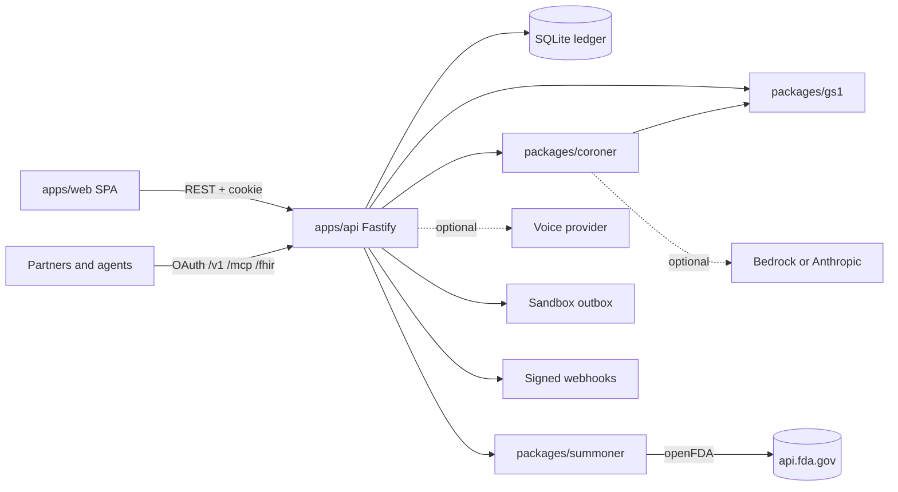
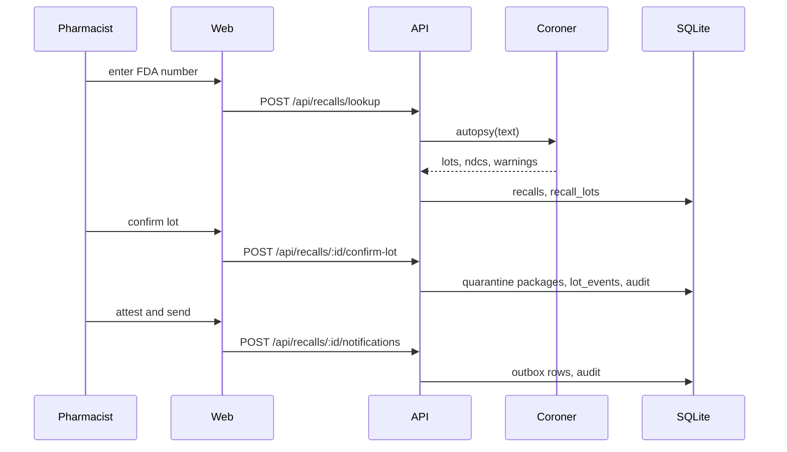
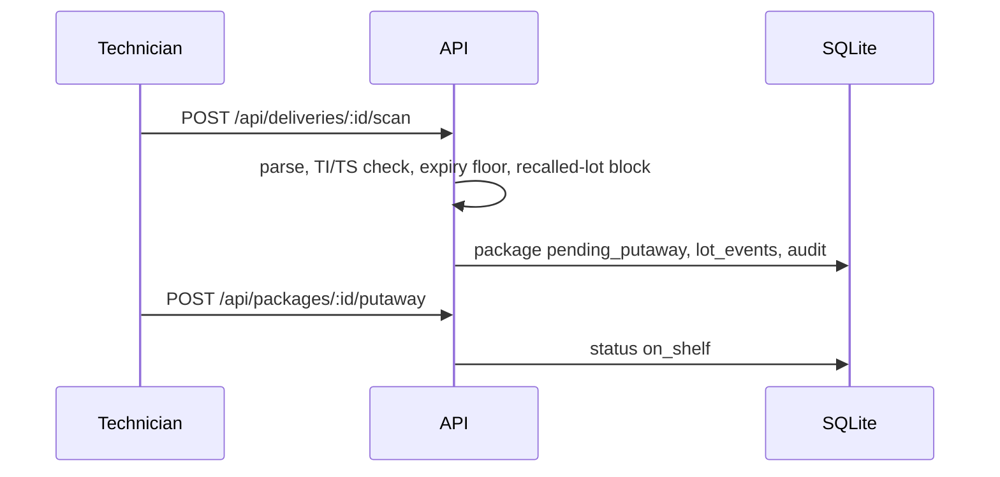

# Architecture

## Architecture Analysis

### System Overview
One Fastify API (`apps/api`) owns the lot ledger in SQLite (`node:sqlite`, file `data/chimera-rx.sqlite`, 36 tables created in `db.ts`). A React SPA (`apps/web`) talks to it over a session-cookie REST API. Partners and agents use a separate OAuth surface. Three pure packages hold GS1 rules, the openFDA client and the lot extractor.

### Architectural Style
Modular monolith in a pnpm workspace. One process, one database, no message bus. Evidence: `apps/api/src/server.ts` wires config, Db, notifier, LLM, voice, cron and the Fastify app in one file. Packages are consumed as TypeScript source with no build step.

### Component Relationships

Text fallback: the web app and partners call the API; the API reads and writes SQLite, uses gs1, coroner and summoner, and sends only to the sandbox outbox and webhooks; coroner may call an LLM and the API may call a voice provider.

### Data Flow
Scan or typed label, then `resolveScan` in `core.ts` normalises to GTIN, NDC, lot, expiry and serial, then receiving or fill writes `packages`, `lots`, `lot_events` and an `audit` row. A recall notice goes through the Coroner, lots are confirmed, packages move to quarantine, and patients come from sold `dispenses`.

### Key Design Decisions
- Rules before the LLM: regex first, LLM second, every LLM lot must appear verbatim in the source (`reconcile.ts`, COR-3).
- Every person-made state change goes through `audit()`; every lot movement through `lotEvent()` (`core.ts`).
- Audit rows commit to the previous row's hash (`auditHash`, `verifyAuditChain`).
- A package (one serial) is the unit of truth; statuses `pending_putaway`, `on_shelf`, `quarantined`, `dispensed`, `returned`, `adjusted`.
- Provider seams: `LlmClient`, `VoiceProvider`, `Notifier` are interfaces with sandbox or optional implementations.

### Improvement Opportunities
- Split `app.ts` (318 lines of route wiring for about 80 routes) by area.
- One SQLite file and one store: no isolation for a hosted multi-user demo.
- No hosted deploy path or container.

## Interaction Diagrams

### Recall to patient message

Text fallback: lookup runs the Coroner, the pharmacist confirms lots, the API quarantines packages and writes audit rows, then the attested send writes sandbox outbox rows.

### Receiving a package

Text fallback: a scan is checked against supplier data, expiry and recalled lots before the package is created; put-away moves it to the shelf.
