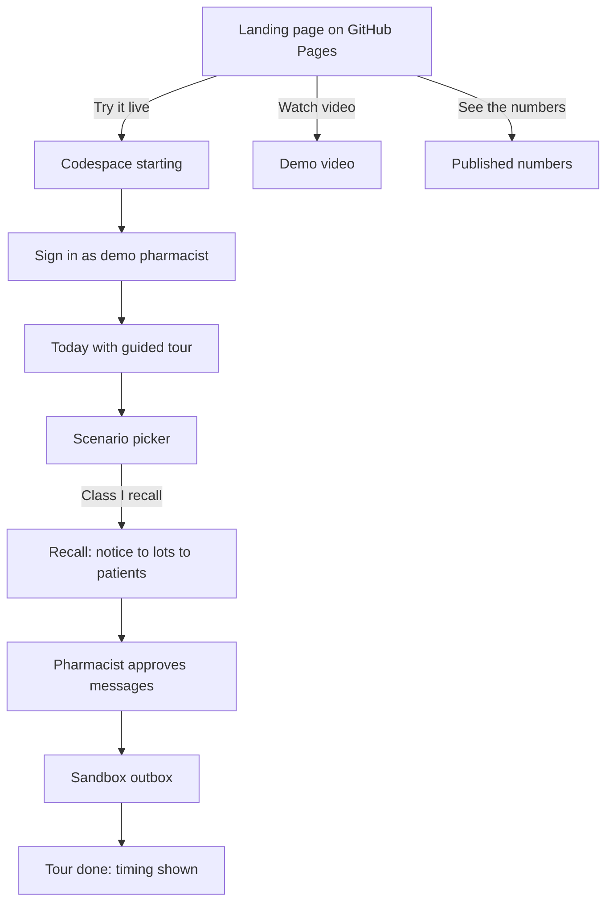

# User Flow: Chimera Rx judge path
## Sources
- [desc] Initial description: "Chimera Rx, a Kiroween 2026 Frankenstein entry, deadline Dec 4 2026. Working code already exists in apps and packages, plan in docs/plan.md. Goal: a working, judge-ready pilot on synthetic data that wins the hackathon, not a product for sale. Find the gaps judges will evaluate (hosted demo, one-command run, scenario library, larger synthetic dataset, published accuracy and timing numbers, Kiro usage evidence, demo video) and plan the build that fills them. Follow .kiro/steering/pharmacy-safety.md. Do not install or add any MCP server."
- [scope] Workflow-selected scope: `mvp`.
- [Q1] New surfaces only.
- [Q2] Landing page then in-app guided tour.
- [Q3] Scenario picker on Today.
- [Q4] Desktop and counter tablet.
- [Q5] WCAG 2.2 AA on the judge path.
- Upstream: `intent-statement.md`, `scope-document.md`, `intent-backlog.md`.
## Core Flow (happy path)

Text version: the judge lands on the GitHub Pages page and can watch the video, see the numbers or press "Try it live". The Codespace starts, the judge signs in as the demo pharmacist, the guided tour opens on Today, the judge picks a scenario, the recall screen goes from notice to lots to patients, the pharmacist approves messages, the messages land in the sandbox outbox, and the tour ends by showing the time taken. [Q2] [Q3] [desc]
## Alternate Paths
- No time to start a Codespace: the judge watches the video and reads the numbers page instead. [Q2]
- Low-confidence lot scenario: the tour stops so the judge confirms each lot by hand, which shows the "a person decides" rule. [Q3] [desc]
- Recalled lot at receiving: the scan is refused and the package is quarantined. [Q3] [desc]
- Store manager switches location in the header; the recall shows patients per location. [Q1]
- Cashier at the front-store register sells an over-the-counter item; a recalled lot is refused at the register. [Q1]
## Information Architecture
- Public (GitHub Pages): Landing, Numbers, Video. [Q2]
- App, staff: Sign in, Today (scenario picker, tour), Receiving, Inventory, Fill and pickup, Patients, Recalls, Register, Integrations, Demo tools (Test labels, Sandbox outbox). [Q1] [desc]
- App header: location switcher, role, demo notice. [Q1] [desc]
## Assumptions & Open Questions
- Timing shown at the end of the tour is measured in the app; the published number comes from the scripted run. [assumption]
- Whether the register lives in the main navigation or only for the cashier role is a later design choice. [assumption]
