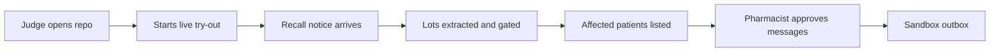

# Intent Backlog: Chimera Rx judge-ready pilot
## Sources
- [desc] Initial description: "Chimera Rx, a Kiroween 2026 Frankenstein entry, deadline Dec 4 2026. Working code already exists in apps and packages, plan in docs/plan.md. Goal: a working, judge-ready pilot on synthetic data that wins the hackathon, not a product for sale. Find the gaps judges will evaluate (hosted demo, one-command run, scenario library, larger synthetic dataset, published accuracy and timing numbers, Kiro usage evidence, demo video) and plan the build that fills them. Follow .kiro/steering/pharmacy-safety.md. Do not install or add any MCP server."
- [scope] Workflow-selected scope: `mvp`.
- [Q1] All six judge-facing items are must-haves.
- [Q2] Retail and hardening stay with schedule risk accepted.
- [Q3] Risk-first order.
- [Q4] Live try-out and video are the key dates.
- [Q5] More locations in, payment and real data out.
## Prioritization Method
MoSCoW, ordered risk first inside each band. Hours come from the feasibility estimate and are rough. [Q3] [assumption]
## Backlog
| Order | Proto-Unit | MoSCoW | Rough hours | Depends on | Source |
|---|---|---|---|---|---|
| 1 | Live try-out: devcontainer, auto-start, README "Open in Codespaces", one-command local backup | Must | 3 to 4 | None | [Q1] [Q3] |
| 2 | Accuracy run: Coroner on real openFDA records, published report | Must | 3 to 4 | None | [Q1] [Q3] |
| 3 | Timing: scripted recall-to-patients run, published number | Must | 2 | 5 for realistic volume | [Q1] |
| 4 | Kiro usage evidence: specs per module, hooks, steering, AI-DLC record summary | Must | 2 to 3 | None | [Q1] |
| 5 | Scenario library and larger synthetic dataset | Must | 3 to 4 | None | [Q1] |
| 6 | Landing page and demo video on GitHub Pages | Must | 4 to 6 | 1, 2, 3, 5 | [Q1] [Q4] |
| 7 | Multiple pharmacy locations | Should | unknown | 5 | [Q2] [Q5] |
| 8 | Front-store retail: register and over-the-counter shopping | Should | unknown | None | [Q2] |
| 9 | Second factor and row-level security | Could | unknown | 7 | [Q2] |
## Cut Line
Items 1 to 6 total about 17 to 23 hours and fill the budget. Items 7 to 9 are first to drop, starting from the bottom, and only with the person's approval. [Q2] [desc]
## Value Stream

Text version: the judge opens the repo, starts the live try-out, a recall notice arrives, lots are extracted and checked, affected patients are listed, the pharmacist approves the messages, and they land in the sandbox outbox. [desc]
## Assumptions & Open Questions
- Hours for items 7 to 9 are unknown until reverse engineering measures what the code already has. [assumption]
- Item 6 grows if the video needs several takes. [assumption]
