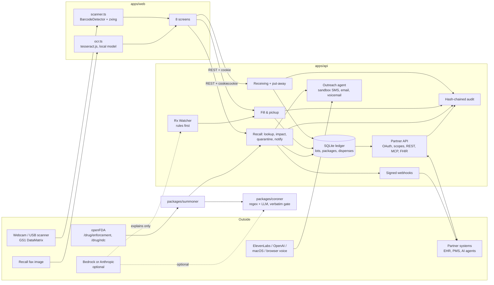

# Architecture

One Fastify API (`apps/api`) owns the lot ledger in SQLite. The React app (`apps/web`) talks to it over a session-cookie REST API. Partners and AI agents use a separate surface (`/oauth/token`, `/v1`, `/mcp`, `/fhir/r4`) with their own credentials and scopes. Three shared packages hold the parts that are pure logic: GS1 rules, the openFDA client and the lot extractor.

## How a recall flows

1. **Notice.** A pharmacist types the FDA recall number, or the browser OCRs the fax image. Night Watch also polls openFDA every 2 hours and opens a recall only if its lots match lots this store holds.
2. **Extract.** The Coroner pulls NDC, lots and expiry from the notice. Regex runs first; an LLM may add candidates, but any lot that is not found verbatim in the source text is dropped.
3. **Confirm.** Lots with confidence ≥ 0.95 and an expiry are confirmed automatically for the pharmacist who looked them up; anything else waits for a per-lot confirmation.
4. **Quarantine.** Every on-shelf package of a confirmed lot moves to Quarantine Q-1. Fills that were scanned but not yet picked up go back to the bench. The lot is now blocked at receiving and at fill.
5. **Impact.** Patients come from the sold dispenses of those lots, which is why the lot is captured at fill. Each patient's reachable channels are computed from consent at that moment.
6. **Notify.** The pharmacist edits the SMS and email templates, ticks the attestation and sends. Messages go to the sandbox outbox. The outreach agent places simulated voicemail calls within calling hours.
7. **Close out.** Return pickup, manufacturer response and a PDF audit report.

## Data

SQLite through built-in `node:sqlite`, file `data/chimera-rx.sqlite`. Main tables:

| Area | Tables |
| --- | --- |
| Staff | `stores`, `users`, `sessions` |
| Ledger | `products`, `lots`, `packages`, `lot_events`, `deliveries`, `delivery_lines`, `ti_records`, `problems` |
| Dispensing | `patients`, `prescriptions`, `dispenses`, `med_history`, `rx_findings`, `prescriber_messages` |
| Recalls | `recalls`, `recall_lots`, `recall_actions`, `fax_inbox`, `notifications`, `outbox`, `outreach_calls`, `audio` |
| Partners | `integrations`, `oauth_tokens`, `api_log`, `webhooks`, `webhook_deliveries`, `webhook_inbox` |
| Audit | `audit` (each row carries the hash of the previous one), `agent_runs`, `events` |

A package is the unit of truth: one row per serial, with a status (`pending_putaway`, `on_shelf`, `quarantined`, `dispensed`, `returned`, `adjusted`). The property test in `apps/api/test/store-flow.test.ts` checks that on hand always equals received minus dispensed, returned and adjusted, and that no serial is dispensed twice.

## Background jobs (`apps/api/src/server.ts`)

| Schedule | Job |
| --- | --- |
| every minute | Rx Watcher reviews new prescriptions |
| every 5 minutes | outreach agent places due voicemail calls (simulated) |
| every 2 hours, and at start-up | Night Watch polls openFDA |

## Staff API (session cookie, role-checked)

| Area | Routes |
| --- | --- |
| Auth | `GET /api/auth/config`, `POST /api/auth/login`, `/sso`, `/logout`, `GET /api/me` |
| Today | `GET /api/today`, `GET /api/search` |
| Receiving | `GET /api/deliveries[/:id]`, `POST /api/deliveries/:id/scan`, `POST /api/packages/:id/putaway`, `/problem` |
| Inventory | `GET /api/lots[/:id]`, `POST /api/lots/:id/move`, `/adjust` |
| Fill | `GET /api/rx[/:rx]`, `/review`, `/change-draft`, `POST /api/rx/:rx/scan`, `/decision`, `POST /api/dispenses/:id/label`, `/verify`, `/sendback`, `/sell` |
| Prescriber | `GET /api/prescriber-messages`, `POST /api/prescriber-messages/:id/respond` |
| Patients | `GET /api/patients[/:id]`, `POST /api/patients/:id/refill-sync` |
| Recalls | `GET /api/recalls[/:id]`, `GET /api/fax`, `POST /api/recalls/lookup`, `/confirm-lot`, `/messages`, `/preview`, `/notifications`, `/results`, `/voicemail`, `/calls`, `/return-pickup`, `/manufacturer-response`, `/close`, `GET /api/recalls/:id/report.pdf` |
| Outreach | `POST /api/outreach/run`, `POST /api/calls/inbound`, `POST /api/sms/inbound` (STOP), `GET /api/outbox`, `GET /api/audio/:id`, `GET /api/voice` |
| Audit | `GET /api/audit`, `/verify`, `/export` |
| Integrations | `GET/POST /api/integrations`, `POST /api/integrations/:id`, `/rotate`, `/webhooks` |
| Demo | `GET /api/demo/labels`, `POST /api/demo/reset`, `POST /api/night-watch/run`, `POST /api/ocr/parse` |

## Partner API (OAuth 2.0 client credentials, per-partner scopes)

| Surface | Routes |
| --- | --- |
| Token | `POST /oauth/token` (1-hour bearer tokens) |
| REST | `GET /v1/availability`, `/v1/inventory`, `/v1/recalls/:fda/status`, `/v1/recalled-lots`, `/v1/change-requests`, `POST /v1/change-requests/:id/response`, `GET /v1/patients/:id/medications` |
| MCP | `POST /mcp` (stateless JSON-RPC; an agent only sees the tools its scopes allow) |
| FHIR R4 | `GET /fhir/r4/metadata`, `Medication`, `MedicationDispense`, `Patient/:id` |

Patient data needs the `patient.read` scope, a BAA flag on the partner record and an admin's approval. Every partner call is written to `api_log`.

## Known limits

- One store, one SQLite file. No multi-tenant isolation or row-level security.
- No second factor; SSO is a demo stand-in.
- The LLM paths were exercised with test doubles, not a live model.
- The camera path was rehearsed with a fake camera, not a physical webcam.
